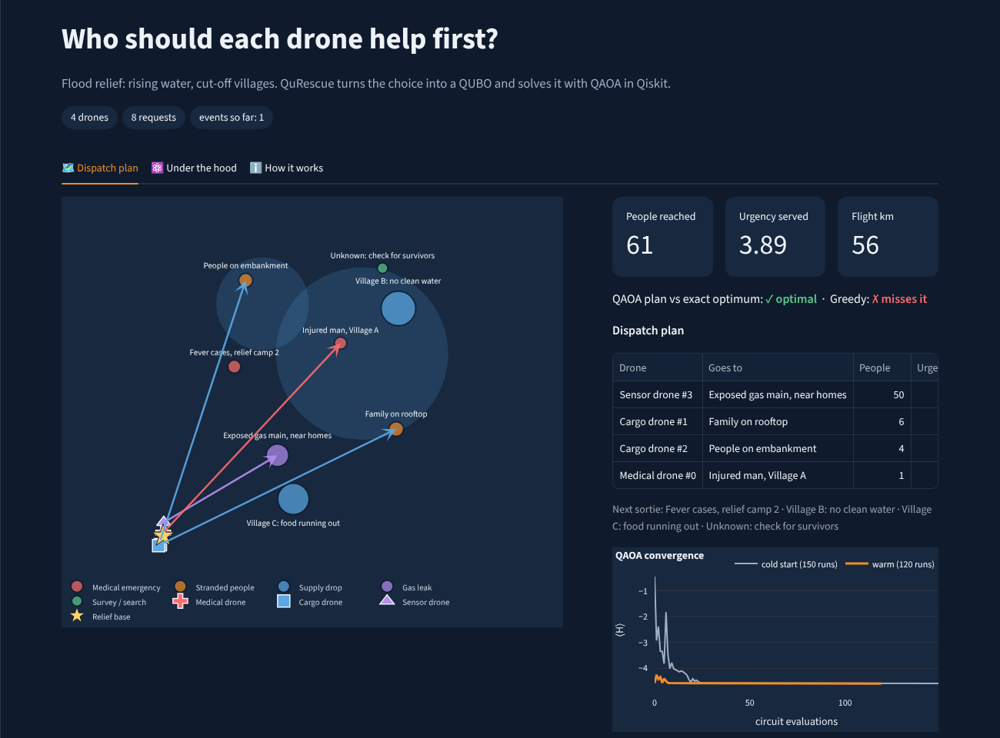
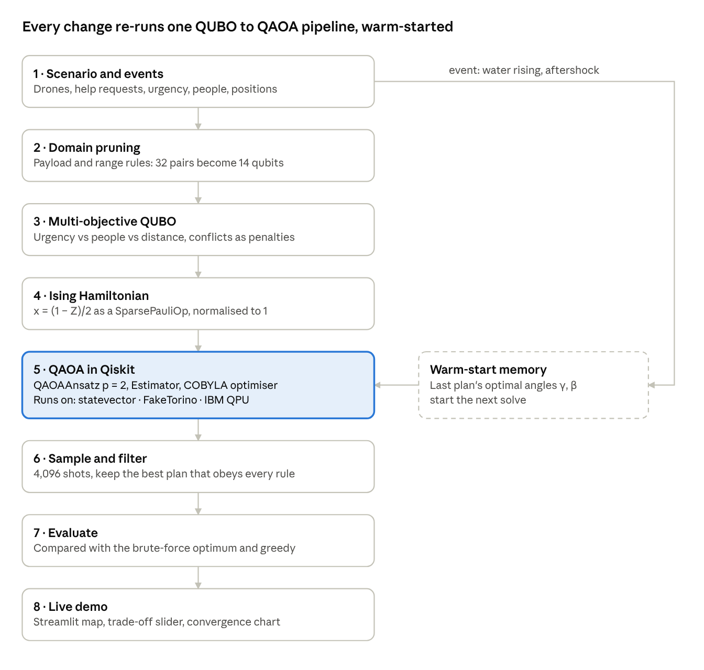

# QuRescue

**Who should the drone help first?**

When a flood hits, a relief camp gets more calls than it has drones. An injured man in one village, a family stuck on a rooftop, 200 people with no clean water, a gas line leaking near houses. Every drone sent one way is a drone not sent another.

QuRescue turns that decision into a QUBO and solves it with QAOA in Qiskit. When the situation changes (the water rises, an aftershock hits), it re-plans by starting QAOA from the last plan's angles instead of from scratch.

Built for the FAST Quantum Fall Fest 2026 hackathon · Domain: **Disaster Response**



## How it works



- **Variables:** one qubit per drone–request pair that actually makes sense (right payload, battery can make the round trip). That rule alone takes the flood case from 32 pairs to 14 qubits.
- **Objective:** a slider α trades *most critical first* against *most people helped*, with a small penalty for distance.
- **Constraints:** one request per drone, one drone per request, written as pairwise penalties so no extra qubits are needed.
- **Solver:** QAOA (p = 2) with COBYLA, then 4,096 samples, keeping the best plan that obeys every rule.
- **Check:** every answer is compared with brute force (the exact optimum) and a greedy heuristic.

## Results

8 change events per scenario. "Optimal" means it matched the brute-force answer.

| Scenario | Qubits | Warm-start QAOA | Cold-start QAOA | Greedy |
|---|---|---|---|---|
| Flood | 14 | 8 / 8 | 7 / 8 | 0 / 8 |
| Earthquake | 10 | 8 / 8 | 6 / 8 | 4 / 8 |
| Border post | 6 | 8 / 8 | 8 / 8 | 8 / 8 |

Warm start also converged in roughly a tenth of the circuit evaluations (about 10 vs 100+).

On a noise model of IBM's Torino processor, the 6-qubit problem still found the optimal plan; by 10 qubits the noise wiped out the signal. That's the main reason the design works so hard to keep problems small.

**What this is not:** a quantum speedup. Brute force solves 14 variables instantly. The point is a clean way to put drone dispatch on quantum hardware, and a re-planning trick that makes QAOA faster and more reliable when things change.

## Run it

```bash
pip install -r requirements.txt
streamlit run app.py                        # the demo
python benchmark.py                         # regenerates results/ (about 2.5 min)
pip install -r requirements-hardware.txt    # only for the IBM scripts below
python run_on_ibm.py --mode border --fake   # IBM device noise model, no account needed
python run_on_ibm.py --mode border          # real IBM hardware (setup notes at top of the file)
```

New to QAOA? `tutorial.ipynb` walks through the whole thing step by step.

## Files

```
qurescue/scenario.py   flood, earthquake and border scenarios + change events
qurescue/qubo.py       the QUBO and its conversion to qubits
qurescue/solvers.py    brute force, greedy, QAOA (cold and warm start)
app.py                 Streamlit demo
benchmark.py           experiments behind the results table
run_on_ibm.py          IBM hardware / noise-model run
tutorial.ipynb         step-by-step walkthrough
```

QuRescue plans rescue, medical, supply and survey flights only. It does no targeting.
